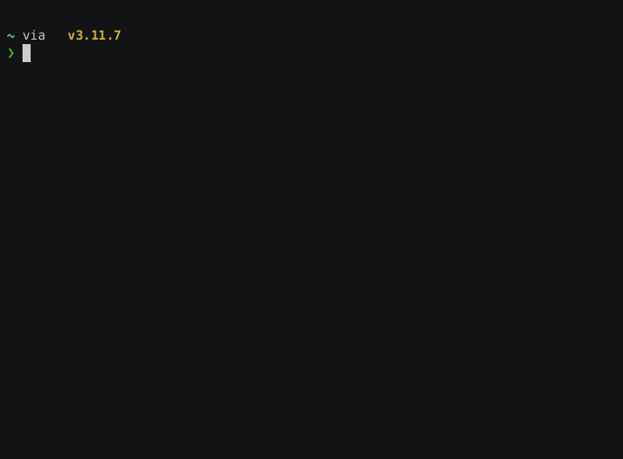

# tonie-podcast-sync
<!-- ALL-CONTRIBUTORS-BADGE:START - Do not remove or modify this section -->
[](#contributors-)
<!-- ALL-CONTRIBUTORS-BADGE:END -->

tonie-podcast-sync permite sincronizar episodios de podcasts a [creative tonies](https://tonies.com).

📖 **[Lee la documentación completa](https://alexhartm.github.io/tonie-podcast-sync/)**

Este es un proyecto puramente privado y no tiene ninguna asociación con Boxine GmbH.

[](https://asciinema.org/a/644812 "Grabación asciicast de tonie-podcast-sync")


# Requisitos previos

- Requiere Python >= 3.10.11
- Si utilizas la función `volume_adjustment` para un podcast, es necesario tener instalado `ffmpeg`

# Uso

tonie-podcast-sync está disponible como [paquete de pip en PyPI](https://pypi.org/project/tonie-podcast-sync). Instálalo mediante:

`pip install tonie-podcast-sync`

Luego, tienes dos opciones para utilizarlo: a través de su CLI o como una biblioteca de Python.

## Vía CLI

La forma más conveniente es simplemente usar la CLI:


Un primer paso es configurar `tonie-podcast-sync`

```bash
tonie-podcast-sync create-settings-file
```

El comando te guiará a través del proceso. La configuración y, opcionalmente, también un archivo secreto se almacenarán en `~/.toniepodcastsync`.

Posteriormente, puedes ejecutar

```bash
tonie-podcast-sync list-tonies
```
para obtener un resumen de tus tonies, y

```bash
tonie-podcast-sync update-tonies
```

para obtener nuevos episodios de podcast y descargarlos en los tonies, y

Si deseas realizar cambios (por ejemplo, cambiar a otro podcast), puedes editar el archivo de configuración `~/.toniepodcastsync/settings.toml` en un editor de texto.

### Formato del archivo de configuración de la CLI

El archivo de configuración admite las siguientes opciones para cada creative tonie:

```toml
[creative_tonies.<tonie-id>]
podcast = "https://example.com/podcast.xml"
name = "My Tonie Name"
episode_sorting = "by_date_newest_first"  # o "by_date_oldest_first", "random"
maximum_length = 90  # Duración máxima en minutos
episode_min_duration_sec = 0  # Duración mínima del episodio en segundos (opcional, predeterminado 0)
episode_max_duration_sec = 5400  # Duración total máxima de los episodios en este tonie en segundos (opcional, predeterminado a lo que el tonie puede almacenar como máximo)
volume_adjustment = 0  # ajuste de volumen en dB (+/-)
excluded_title_strings = ["vampir", "brokkoli"]  # filtrar episodios terroríficos
pinned_episode_names = ["the golden goose", "hans in luck"] # fijar ciertos episodios para que siempre se suban
wipe = true  # Si se debe borrar el contenido existente antes de sincronizar (opcional, predeterminado true)
```

El campo `excluded_title_strings` es opcional y te permite filtrar los episodios cuyos títulos contengan alguna de las cadenas especificadas (coincidencia insensible a mayúsculas/minúsculas).

El campo `pinned_episode_names` es opcional y te permite fijar (es decir, siempre subir) los episodios cuyos títulos contengan alguno de los nombres de episodio especificados (coincidencia insensible a mayúsculas/minúsculas).

El campo `episode_max_duration_sec` es opcional. Filtra los episodios individuales que superen esta duración. Ten en cuenta que esto es diferente de `maximum_length`, que controla la duración total de los episodios colocados en el tonie.

El campo `wipe` es opcional y controla si se debe borrar el contenido existente en el tonie antes de sincronizar nuevos episodios. Si se establece en `true` (el predeterminado), todo el contenido existente se eliminará antes de agregar nuevos episodios. Si se establece en `false`, los nuevos episodios se agregarán al contenido existente.

Para buscar periódicamente nuevos episodios, puedes programar `tonie-podcast-sync`, por ejemplo, a través de systemd (en un sistema operativo Linux).

Además,

```bash
tonie-podcast-sync --help
```

proporciona un resumen de estos y otros comandos disponibles.


## En tus propios scripts de Python

Puedes usar `tonie-podcast-sync` importándolo en tus propios scripts de Python, como en este código de ejemplo:

```python
from tonie_podcast_sync.toniepodcastsync import ToniePodcastSync, Podcast, EpisodeSorting

# Crea algunos objetos Podcast, proporcionando la URL del feed a cada uno
pumuckl = Podcast("https://feeds.br.de/pumuckl/feed.xml")

# De forma predeterminada, los podcasts se colocan en los Tonies comenzando por el episodio más reciente
# Si deseas cambiar el orden de los episodios, están disponibles las siguientes opciones
# - EpisodeSorting.BY_DATE_NEWEST_FIRST (predeterminado)
# - EpisodeSorting.BY_DATE_OLDEST_FIRST
# - EpisodeSorting.RADNOM
maus_60min = Podcast(
    "https://kinder.wdr.de/radio/diemaus/audio/diemaus-60/diemaus-60-106.podcast",
    episode_sorting = EpisodeSorting.BY_DATE_NEWEST_FIRST
)
maus_gute_nacht = Podcast(
    "https://kinder.wdr.de/radio/diemaus/audio/gute-nacht-mit-der-maus/diemaus-gute-nacht-104.podcast",
    episode_sorting = EpisodeSorting.RANDOM
)

# Si deseas ajustar el volumen de un podcast, establece volume_adjustment en un número entero distinto de 0
# El audio se ajustará (+/-) en esa cantidad en dB
anne_und_die_wilden_tiere = Podcast(
    "https://feeds.br.de/anna-und-die-wilden-tiere/feed.xml",
    episode_sorting = EpisodeSorting.RANDOM,
    volume_adjustment = -2
)

# Algunos podcasts inyectan episodios muy cortos (por ejemplo, anunciando un descanso por vacaciones).
# `episode_min_duration_sec` se puede usar para filtrar todos los episodios más cortos que este valor.
# el ejemplo siguiente omitirá todos los episodios más cortos que 30 segundos.
checker_tobi = Podcast(
    "https://feeds.br.de/checkpod-der-podcast-mit-checker-tobi/feed.xml",
    episode_sorting = EpisodeSorting.RANDOM,
    episode_min_duration_sec = 30
)

# También puedes filtrar episodios por cadenas de título. Los episodios con títulos que contengan
# cualquiera de las cadenas especificadas (insensible a mayúsculas/minúsculas) se excluirán.
# Esto es útil para filtrar episodios que sean demasiado terroríficos (por ejemplo).
maus_filtered = Podcast(
    "https://kinder.wdr.de/radio/diemaus/audio/maus-gute-nacht/maus-gute-nacht-148.podcast",
    excluded_title_strings = ["vampir", "brokkoli"]
)

# También es posible fijar ciertos episodios por su título. Los episodios con títulos que contengan
# cualquiera de los nombres especificados (insensible a mayúsculas/minúsculas) tendrán prioridad para su carga.
# Esto es útil para fijar cualquier episodio(s) favorito(s).
maus_filtered = Podcast(
    "https://kinder.wdr.de/radio/diemaus/audio/maus-gute-nacht/maus-gute-nacht-148.podcast",
    pinned_episode_names = ["zaubervogel", "auf eis"]
)

# Crea una instancia de ToniePodcastSync
tps = ToniePodcastSync("<toniecloud-username>", "<toniecloud-password>")

# Para obtener un resumen de tus creative Tonies y sus IDs
# Los IDs son necesarios para direccionar Tonies específicos en el siguiente paso
tps.print_tonies_overview()

# Define creative Tonies basándote en su ID
greenTonie = "<your-tonieID>"
orangeTonie = "<your-tonieID>"
greyTonie = "<your-tonieID>"

# Obtén nuevos episodios de podcast y cópialos en greenTonie.
# El tonie se llenará con la mayor cantidad de episodios que quepan (90 min máx).
tps.sync_podcast_to_tonie(pumuckl, greenTonie)

# Los niños deberían quedarse dormidos, así que limitemos el podcast
# de los episodios en este tonie a 60 minutos en total.
# Usa el parámetro opcional para esto:
tps.sync_podcast_to_tonie(maus_gute_nacht, orangeTonie, 60)

# De forma predeterminada, sincronizar un podcast con un tonie eliminará todo
# el contenido existente en ese tonie:
tps.sync_podcast_to_tonie(checker_tobi, greyTonie, 30)
# Si deseas agregar episodios sin eliminar el contenido existente
# en el tonie, usa el parámetro wipe=False:
tps.sync_podcast_to_tonie(checker_tobi, greyTonie, 30, wipe=False)
```

Para que el tonie obtenga nuevo contenido desde tonie-cloud, debes presionar una oreja durante 3 segundos (hasta escuchar el sonido "ping") sin tener ningún tonie sobre la caja (consulta también el manual de TonieBox).

## Como contenedor Docker

@goldbricklemon ha creado un contenedor Docker para esto: [docker-tonie-podcast-sync](https://github.com/goldbricklemon/docker-tonie-podcast-sync).

# Contribuyentes

<!-- ALL-CONTRIBUTORS-LIST:START - Do not remove or modify this section -->
<!-- prettier-ignore-start -->
<!-- markdownlint-disable -->
<table>
  <tbody>
    <tr>
      <td align="center" valign="top" width="14.28%"><a href="https://github.com/alexhartm"><br /><sub><b>Alexander Hartmann</b></sub></a><br /><a href="https://github.com/alexhartm/tonie-podcast-sync/commits?author=alexhartm" title="Code">💻</a> <a href="#ideas-alexhartm" title="Ideas, Planning, & Feedback">🤔</a> <a href="#maintenance-alexhartm" title="Maintenance">🚧</a></td>
      <td align="center" valign="top" width="14.28%"><a href="https://github.com/Wilhelmsson177"><br /><sub><b>Wilhelmsson177</b></sub></a><br /><a href="https://github.com/alexhartm/tonie-podcast-sync/commits?author=Wilhelmsson177" title="Code">💻</a> <a href="#ideas-Wilhelmsson177" title="Ideas, Planning, & Feedback">🤔</a> <a href="#maintenance-Wilhelmsson177" title="Maintenance">🚧</a> <a href="https://github.com/alexhartm/tonie-podcast-sync/commits?author=Wilhelmsson177" title="Tests">⚠️</a></td>
      <td align="center" valign="top" width="14.28%"><a href="https://cv.maltebaer.vercel.app/"><br /><sub><b>Malte Bär</b></sub></a><br /><a href="https://github.com/alexhartm/tonie-podcast-sync/issues?q=author%3Amaltebaer" title="Bug reports">🐛</a></td>
      <td align="center" valign="top" width="14.28%"><a href="https://github.com/einvalentin"><br /><sub><b>Valentin v. Seggern</b></sub></a><br /><a href="https://github.com/alexhartm/tonie-podcast-sync/commits?author=einvalentin" title="Code">💻</a></td>
      <td align="center" valign="top" width="14.28%"><a href="https://github.com/stefan14808"><br /><sub><b>stefan14808</b></sub></a><br /><a href="https://github.com/alexhartm/tonie-podcast-sync/commits?author=stefan14808" title="Code">💻</a> <a href="#ideas-stefan14808" title="Ideas, Planning, & Feedback">🤔</a></td>
      <td align="center" valign="top" width="14.28%"><a href="https://github.com/goldbricklemon"><br /><sub><b>GoldBrickLemon</b></sub></a><br /><a href="https://github.com/alexhartm/tonie-podcast-sync/issues?q=author%3Agoldbricklemon" title="Bug reports">🐛</a> <a href="https://github.com/alexhartm/tonie-podcast-sync/commits?author=goldbricklemon" title="Code">💻</a></td>
      <td align="center" valign="top" width="14.28%"><a href="https://github.com/Andrewpk"><br /><sub><b>Andrew Kehrig</b></sub></a><br /><a href="https://github.com/alexhartm/tonie-podcast-sync/commits?author=Andrewpk" title="Code">💻</a></td>
    </tr>
  </tbody>
</table>

<!-- markdownlint-restore -->
<!-- prettier-ignore-end -->

<!-- ALL-CONTRIBUTORS-LIST:END -->

> Utiliza el [bot de all-contributors de GitHub](https://allcontributors.org/docs/en/bot/usage) para agregar contribuyentes aquí.

## Se basa en el trabajo de / agradecimientos a
- La increíble [tonie_api](https://github.com/moritzj29/tonie_api) de moritj29
- [Tobias Raabe](https://tobiasraabe.github.io/blog/how-to-download-files-with-python.html)
- [Matthew Wimberly](https://codeburst.io/building-an-rss-feed-scraper-with-python-73715ca06e1f)
